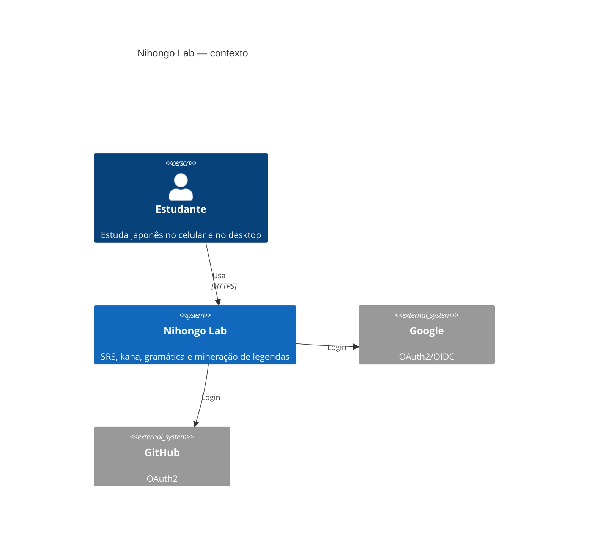
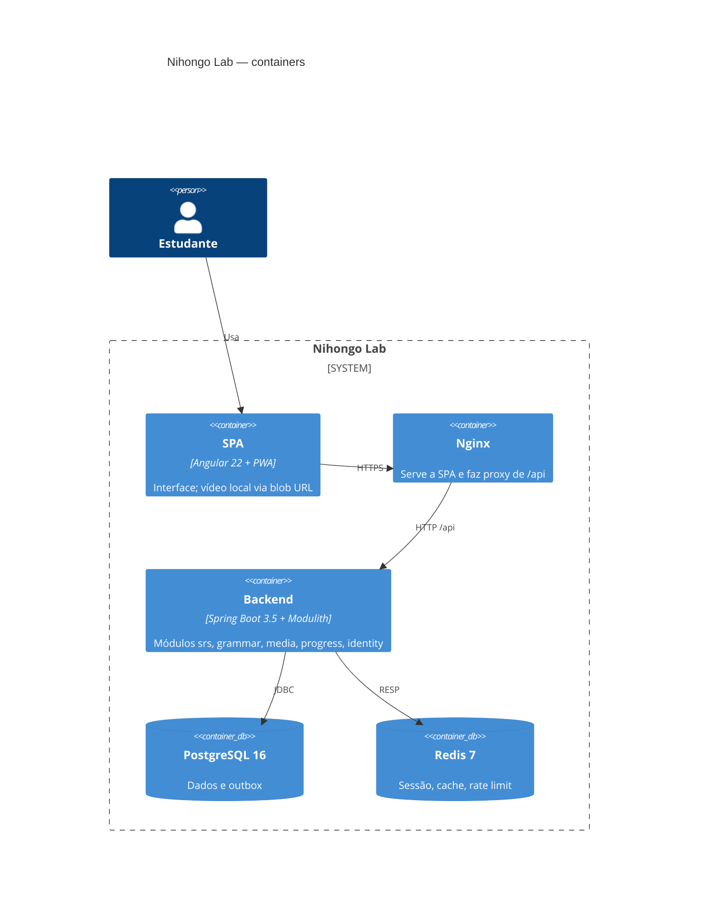

# Fase 0 — Fundação (passo a passo)

Spec: `.sdd/f0-fundacao/spec/`. Cada seção abaixo é um passo do `plano.md`.

---

## Passo 1 — Base do monorepo

```bash
cd ~/Documents/projetos/aprender-japones
git init -b main
mkdir -p backend frontend infra .github/workflows docs/adr
```

`.gitignore`:

```gitignore
# segredos
.env
# Java
backend/target/
*.class
# Node / Angular
frontend/node_modules/
frontend/dist/
frontend/.angular/
# IDE / SO
.idea/
*.iml
.vscode/*
!.vscode/extensions.json
.DS_Store
```

`.editorconfig`:

```ini
root = true

[*]
charset = utf-8
end_of_line = lf
insert_final_newline = true
indent_style = space
indent_size = 2

[*.java]
indent_size = 4
```

`.env.example` — copie de `.sdd/f0-fundacao/spec/contrato.md` → "Variáveis de ambiente". Depois:

```bash
cp .env.example .env
git check-ignore .env          # C01: deve imprimir ".env"
git add -A && git commit -m "chore: base do monorepo" -m "Sdd-Task: f0-fundacao#1"
```

---

## Passo 2 — Postgres e Redis de dev

`infra/docker-compose.dev.yml`:

```yaml
name: nihongolab-dev

services:
  postgres:
    image: postgres:16-alpine
    environment:
      POSTGRES_DB: ${POSTGRES_DB}
      POSTGRES_USER: ${POSTGRES_USER}
      POSTGRES_PASSWORD: ${POSTGRES_PASSWORD}
    ports:
      - "127.0.0.1:5432:5432"
    volumes:
      - pgdata:/var/lib/postgresql/data
    healthcheck:
      test: ["CMD-SHELL", "pg_isready -U $${POSTGRES_USER} -d $${POSTGRES_DB}"]
      interval: 5s
      timeout: 3s
      retries: 10

  redis:
    image: redis:7-alpine
    ports:
      - "127.0.0.1:6379:6379"
    healthcheck:
      test: ["CMD", "redis-cli", "ping"]
      interval: 5s
      timeout: 3s
      retries: 10

volumes:
  pgdata:
```

`$$` escapa o `$` para o compose não interpolar; a variável é lida dentro do container.

```bash
docker compose --env-file .env -f infra/docker-compose.dev.yml up -d --wait   # C02
docker compose --env-file .env -f infra/docker-compose.dev.yml ps
```

---

## Passo 3 — Esqueleto do backend

### `backend/pom.xml`

Spring Boot 3.5 (D-01). O start.spring.io pode não oferecer mais o 3.5, por isso o `pom.xml` vai escrito à mão. Antes de colar, confira no Maven Central a última patch de cada versão marcada.

```xml
<?xml version="1.0" encoding="UTF-8"?>
<project xmlns="http://maven.apache.org/POM/4.0.0"
         xmlns:xsi="http://www.w3.org/2001/XMLSchema-instance"
         xsi:schemaLocation="http://maven.apache.org/POM/4.0.0 https://maven.apache.org/xsd/maven-4.0.0.xsd">
  <modelVersion>4.0.0</modelVersion>

  <parent>
    <groupId>org.springframework.boot</groupId>
    <artifactId>spring-boot-starter-parent</artifactId>
    <version>3.5.16</version>
    <relativePath/>
  </parent>

  <groupId>dev.nihongolab</groupId>
  <artifactId>nihongolab-backend</artifactId>
  <version>0.0.1-SNAPSHOT</version>

  <properties>
    <java.version>21</java.version>
    <spring-modulith.version>1.4.5</spring-modulith.version>        <!-- última 1.4.x -->
    <archunit.version>1.4.1</archunit.version>                      <!-- última 1.x -->
    <testcontainers-redis.version>2.2.4</testcontainers-redis.version>
  </properties>

  <dependencyManagement>
    <dependencies>
      <dependency>
        <groupId>org.springframework.modulith</groupId>
        <artifactId>spring-modulith-bom</artifactId>
        <version>${spring-modulith.version}</version>
        <type>pom</type>
        <scope>import</scope>
      </dependency>
    </dependencies>
  </dependencyManagement>

  <dependencies>
    <dependency><groupId>org.springframework.boot</groupId><artifactId>spring-boot-starter-web</artifactId></dependency>
    <dependency><groupId>org.springframework.boot</groupId><artifactId>spring-boot-starter-validation</artifactId></dependency>
    <dependency><groupId>org.springframework.boot</groupId><artifactId>spring-boot-starter-data-jpa</artifactId></dependency>
    <dependency><groupId>org.springframework.boot</groupId><artifactId>spring-boot-starter-data-redis</artifactId></dependency>
    <dependency><groupId>org.springframework.boot</groupId><artifactId>spring-boot-starter-security</artifactId></dependency>
    <dependency><groupId>org.springframework.boot</groupId><artifactId>spring-boot-starter-oauth2-client</artifactId></dependency>
    <dependency><groupId>org.springframework.boot</groupId><artifactId>spring-boot-starter-actuator</artifactId></dependency>
    <dependency><groupId>org.springframework.session</groupId><artifactId>spring-session-data-redis</artifactId></dependency>
    <dependency><groupId>org.flywaydb</groupId><artifactId>flyway-core</artifactId></dependency>
    <dependency><groupId>org.flywaydb</groupId><artifactId>flyway-database-postgresql</artifactId></dependency>
    <dependency><groupId>org.postgresql</groupId><artifactId>postgresql</artifactId><scope>runtime</scope></dependency>
    <dependency><groupId>io.micrometer</groupId><artifactId>micrometer-registry-prometheus</artifactId><scope>runtime</scope></dependency>
    <dependency><groupId>org.springframework.modulith</groupId><artifactId>spring-modulith-starter-core</artifactId></dependency>
    <dependency><groupId>org.springframework.modulith</groupId><artifactId>spring-modulith-starter-jdbc</artifactId></dependency>

    <dependency><groupId>org.springframework.boot</groupId><artifactId>spring-boot-starter-test</artifactId><scope>test</scope></dependency>
    <dependency><groupId>org.springframework.boot</groupId><artifactId>spring-boot-testcontainers</artifactId><scope>test</scope></dependency>
    <dependency><groupId>org.springframework.security</groupId><artifactId>spring-security-test</artifactId><scope>test</scope></dependency>
    <dependency><groupId>org.springframework.modulith</groupId><artifactId>spring-modulith-starter-test</artifactId><scope>test</scope></dependency>
    <dependency><groupId>org.testcontainers</groupId><artifactId>postgresql</artifactId><scope>test</scope></dependency>
    <dependency><groupId>org.testcontainers</groupId><artifactId>junit-jupiter</artifactId><scope>test</scope></dependency>
    <dependency><groupId>com.redis</groupId><artifactId>testcontainers-redis</artifactId><version>${testcontainers-redis.version}</version><scope>test</scope></dependency>
    <dependency><groupId>com.tngtech.archunit</groupId><artifactId>archunit-junit5</artifactId><version>${archunit.version}</version><scope>test</scope></dependency>
  </dependencies>

  <build>
    <plugins>
      <plugin>
        <groupId>org.springframework.boot</groupId>
        <artifactId>spring-boot-maven-plugin</artifactId>
      </plugin>
    </plugins>
  </build>
</project>
```

Por que `flyway-database-postgresql`: desde o Flyway 10, o suporte a cada banco é um módulo separado.

```bash
cd backend && mvn -N wrapper:wrapper && ./mvnw -v
```

### Classe principal

`backend/src/main/java/dev/nihongolab/NihongolabApplication.java`:

```java
package dev.nihongolab;

import java.time.Clock;
import java.time.ZoneOffset;

import org.springframework.boot.SpringApplication;
import org.springframework.boot.autoconfigure.SpringBootApplication;
import org.springframework.context.annotation.Bean;
import org.springframework.scheduling.annotation.EnableAsync;

@SpringBootApplication
@EnableAsync
public class NihongolabApplication {

    public static void main(String[] args) {
        SpringApplication.run(NihongolabApplication.class, args);
    }

    @Bean
    Clock clock() {
        return Clock.tickMillis(ZoneOffset.UTC);
    }
}
```

`@EnableAsync` é o que faz o `@ApplicationModuleListener` rodar em outra thread.

### Módulos

Um `package-info.java` por módulo. Exemplo `backend/src/main/java/dev/nihongolab/srs/package-info.java`:

```java
@ApplicationModule(displayName = "SRS")
package dev.nihongolab.srs;

import org.springframework.modulith.ApplicationModule;
```

O `shared` é aberto (todos podem usar tudo dele):

```java
@ApplicationModule(displayName = "Shared Kernel", type = ApplicationModule.Type.OPEN)
package dev.nihongolab.shared;

import org.springframework.modulith.ApplicationModule;
```

Repita para `grammar`, `media`, `progress`, `identity`.

### `backend/src/main/resources/application.yml`

```yaml
spring:
  application:
    name: nihongolab
  jpa:
    open-in-view: false
    hibernate:
      ddl-auto: validate
  flyway:
    enabled: true
  modulith:
    events:
      jdbc:
        schema-initialization:
          enabled: false
      republish-outstanding-events-on-restart: true
  threads:
    virtual:
      enabled: true
  mvc:
    problemdetails:
      enabled: true

management:
  endpoints:
    web:
      exposure:
        include: health,info,prometheus
  endpoint:
    health:
      show-details: never

logging:
  structured:
    format:
      console: ecs
```

Sem URL nem senha: vêm de `SPRING_DATASOURCE_*` e `SPRING_DATA_REDIS_URL` (variáveis de ambiente) ou do Testcontainers.

### Segurança mínima

`backend/src/main/java/dev/nihongolab/identity/adapter/in/web/SecurityConfig.java`:

```java
package dev.nihongolab.identity.adapter.in.web;

import org.springframework.context.annotation.Bean;
import org.springframework.context.annotation.Configuration;
import org.springframework.http.HttpStatus;
import org.springframework.security.config.annotation.web.builders.HttpSecurity;
import org.springframework.security.config.annotation.web.configurers.AbstractHttpConfigurer;
import org.springframework.security.web.SecurityFilterChain;
import org.springframework.security.web.authentication.HttpStatusEntryPoint;

@Configuration
class SecurityConfig {

    @Bean
    SecurityFilterChain securityFilterChain(HttpSecurity http) throws Exception {
        http
            .authorizeHttpRequests(auth -> auth
                .requestMatchers("/actuator/health", "/actuator/health/**").permitAll()
                .anyRequest().authenticated())
            .httpBasic(AbstractHttpConfigurer::disable)
            .formLogin(AbstractHttpConfigurer::disable)
            .exceptionHandling(e -> e.authenticationEntryPoint(new HttpStatusEntryPoint(HttpStatus.UNAUTHORIZED)));
        return http.build();
    }
}
```

Sem o `HttpStatusEntryPoint`, com basic e form desligados, o Spring responde 403 em vez de 401.

### Rodar

```bash
set -a && . ./.env && set +a
cd backend && ./mvnw spring-boot:run
curl -s localhost:8080/actuator/health        # {"status":"UP"}
```

Até o passo 4, o Flyway só avisa que não encontrou migrações.

---

## Passo 4 — Outbox e base de teste

`backend/src/main/resources/db/migration/V001__shared_event_publication.sql`: copie o DDL de `docs/sdd/dados.md`. Confira contra o arquivo oficial do jar:

```bash
cd backend && ./mvnw dependency:copy -Dartifact=org.springframework.modulith:spring-modulith-events-jdbc:1.4.5 -DoutputDirectory=/tmp/m
unzip -p /tmp/m/spring-modulith-events-jdbc-1.4.5.jar schema-postgresql.sql
```

`backend/src/test/java/dev/nihongolab/TestcontainersConfiguration.java`:

```java
package dev.nihongolab;

import com.redis.testcontainers.RedisContainer;
import org.springframework.boot.test.context.TestConfiguration;
import org.springframework.boot.testcontainers.service.connection.ServiceConnection;
import org.springframework.context.annotation.Bean;
import org.testcontainers.containers.PostgreSQLContainer;
import org.testcontainers.utility.DockerImageName;

@TestConfiguration(proxyBeanMethods = false)
public class TestcontainersConfiguration {

    @Bean
    @ServiceConnection
    PostgreSQLContainer<?> postgres() {
        return new PostgreSQLContainer<>(DockerImageName.parse("postgres:16-alpine"));
    }

    @Bean
    @ServiceConnection
    RedisContainer redis() {
        return new RedisContainer(DockerImageName.parse("redis:7-alpine"));
    }
}
```

Se o `@ServiceConnection` não reconhecer o `RedisContainer`, troque por `GenericContainer<?>` com `.withExposedPorts(6379)` e `@ServiceConnection(name = "redis")`.

`backend/src/test/java/dev/nihongolab/IntegrationTest.java`:

```java
package dev.nihongolab;

import org.springframework.boot.test.context.SpringBootTest;
import org.springframework.context.annotation.Import;

@SpringBootTest(webEnvironment = SpringBootTest.WebEnvironment.RANDOM_PORT)
@Import(TestcontainersConfiguration.class)
public abstract class IntegrationTest {
}
```

Teste do C04 — `InfrastructureIntegrationTest.java`:

```java
class InfrastructureIntegrationTest extends IntegrationTest {

    @Autowired JdbcClient jdbc;

    @Test
    void appliesOutboxMigration() {
        Integer applied = jdbc.sql("select count(*) from flyway_schema_history where version = '001' and success")
                .query(Integer.class).single();
        String table = jdbc.sql("select to_regclass('public.event_publication')::text")
                .query(String.class).single();

        assertThat(applied).isEqualTo(1);
        assertThat(table).isEqualTo("event_publication");
    }
}
```

Teste do C05: `TestRestTemplate` em `/actuator/health` (200, `$.status == "UP"`) e em `/api/qualquer-coisa` (401, sem `WWW-Authenticate`).

**Armadilha de nome:** o Surefire só roda classes terminadas em `Test`, `Tests` ou `TestCase`. Uma classe `*IT` não roda sem o Failsafe. Use o sufixo `IntegrationTest`.

**Armadilha de contexto:** cada combinação diferente de `@Import`/propriedades cria um contexto Spring novo **e containers novos**. Mantenha poucas classes base.

---

## Passo 5 — Guardiões de arquitetura

`backend/src/test/java/dev/nihongolab/architecture/ArchitectureRules.java`:

```java
package dev.nihongolab.architecture;

import static com.tngtech.archunit.lang.syntax.ArchRuleDefinition.classes;
import static com.tngtech.archunit.lang.syntax.ArchRuleDefinition.noClasses;

import com.tngtech.archunit.lang.ArchRule;
import jakarta.persistence.Entity;
import org.springframework.web.bind.annotation.RestController;

public final class ArchitectureRules {

    public static final ArchRule DOMAIN_IS_PURE = noClasses()
            .that().resideInAPackage("..domain..")
            .and().doNotHaveSimpleName("package-info")
            .should().dependOnClassesThat().resideInAnyPackage(
                    "org.springframework..", "jakarta.persistence..", "com.fasterxml..",
                    "..application..", "..adapter..")
            .as("DOMAIN_IS_PURE")
            .allowEmptyShould(true);

    public static final ArchRule APPLICATION_DOES_NOT_DEPEND_ON_ADAPTER = noClasses()
            .that().resideInAPackage("..application..")
            .should().dependOnClassesThat().resideInAPackage("..adapter..")
            .as("APPLICATION_DOES_NOT_DEPEND_ON_ADAPTER")
            .allowEmptyShould(true);

    public static final ArchRule ENTITIES_ONLY_IN_PERSISTENCE_ADAPTER = classes()
            .that().areAnnotatedWith(Entity.class)
            .should().resideInAPackage("..adapter.out.persistence..")
            .as("ENTITIES_ONLY_IN_PERSISTENCE_ADAPTER")
            .allowEmptyShould(true);

    public static final ArchRule CONTROLLERS_ONLY_IN_WEB_ADAPTER = classes()
            .that().areAnnotatedWith(RestController.class)
            .should().resideInAPackage("..adapter.in.web..")
            .as("CONTROLLERS_ONLY_IN_WEB_ADAPTER")
            .allowEmptyShould(true);

    private ArchitectureRules() {
    }
}
```

`allowEmptyShould(true)`: na Fase 0 não há classe em `..domain..`, e o ArchUnit falha regra que não encontrou nada.

`doNotHaveSimpleName("package-info")`: a partir da Fase 1, `domain/event/package-info.java` leva `@NamedInterface` do Modulith. É metadado de módulo, não dependência do código de domínio.

`ArchitectureTest.java`:

```java
@AnalyzeClasses(packages = "dev.nihongolab", importOptions = ImportOption.DoNotIncludeTests.class)
class ArchitectureTest {
    @ArchTest static final ArchRule domainIsPure = ArchitectureRules.DOMAIN_IS_PURE;
    @ArchTest static final ArchRule applicationIndependent = ArchitectureRules.APPLICATION_DOES_NOT_DEPEND_ON_ADAPTER;
    @ArchTest static final ArchRule entities = ArchitectureRules.ENTITIES_ONLY_IN_PERSISTENCE_ADAPTER;
    @ArchTest static final ArchRule controllers = ArchitectureRules.CONTROLLERS_ONLY_IN_WEB_ADAPTER;
}
```

Fixtures (só em `src/test`), por exemplo `archfixture/srs/domain/SpringInDomain.java` (pacote fora de `dev.nihongolab`, para o scan do Spring/Hibernate não capturá-las):

```java
package archfixture.srs.domain;

import org.springframework.context.ApplicationEventPublisher;

public class SpringInDomain {
    ApplicationEventPublisher publisher;
}
```

Crie também `archfixture/srs/adapter/out/persistence/SomeAdapter`, `archfixture/srs/application/AdapterInApplication` (com campo `SomeAdapter`), `archfixture/srs/domain/MisplacedEntity` (`@Entity`) e `archfixture/srs/application/MisplacedController` (`@RestController`).

`ArchitectureRulesSelfTest.java` (C03):

```java
class ArchitectureRulesSelfTest {

    static final JavaClasses FIXTURES = new ClassFileImporter().importPackages("archfixture");

    @Test
    void domainRuleCatchesSpringDependency() {
        assertThatThrownBy(() -> ArchitectureRules.DOMAIN_IS_PURE.check(FIXTURES))
                .isInstanceOf(AssertionError.class)
                .hasMessageContaining("SpringInDomain");
    }

    // um teste por regra, com a fixture correspondente
}
```

`ModularityTest.java` (C06):

```java
class ModularityTest {

    static final ApplicationModules modules = ApplicationModules.of(NihongolabApplication.class);

    @Test
    void verifiesModularStructure() {
        modules.verify();
    }

    @Test
    void writesDocumentation() {
        new Documenter(modules).writeDocumentation();
    }
}
```

C03b à mão: crie `src/main/java/dev/nihongolab/srs/domain/Tmp.java` com `import org.springframework.stereotype.Component;` e `@Component`, rode `./mvnw verify` (deve falhar em `DOMAIN_IS_PURE`), apague a classe.

---

## Passo 6 — Esqueleto do frontend

```bash
ng new frontend --routing --style=scss --ssr=false --skip-git
cd frontend
```

`frontend/proxy.conf.json`:

```json
{
  "/api":    { "target": "http://localhost:8080", "secure": false, "changeOrigin": false },
  "/oauth2": { "target": "http://localhost:8080", "secure": false, "changeOrigin": false },
  "/login":  { "target": "http://localhost:8080", "secure": false, "changeOrigin": false }
}
```

`package.json` → `"start": "ng serve --proxy-config proxy.conf.json"`.

`src/app/app.html`: troque o conteúdo gerado por algo como `<h1>Nihongo Lab</h1><router-outlet />`.

`src/app/app.spec.ts` (C07):

```ts
import { TestBed } from '@angular/core/testing';
import { App } from './app';

describe('App', () => {
  beforeEach(async () => {
    await TestBed.configureTestingModule({ imports: [App] }).compileComponents();
  });

  it('mostra o nome do produto', async () => {
    const fixture = TestBed.createComponent(App);
    await fixture.whenStable();
    expect(fixture.nativeElement.querySelector('h1')?.textContent).toContain('Nihongo Lab');
  });
});
```

```bash
npm test -- --watch=false     # C07
npm run build                 # C08: gera dist/frontend/browser/index.html
```

Se o `ng new` gerou nomes diferentes (`app.component.ts`), use os nomes gerados; o importante é o comportamento do cartão.

---

## Passo 7 — CI

`.github/workflows/ci.yml`:

```yaml
name: ci

on:
  push:
    branches: [main]
  pull_request:

jobs:
  backend:
    runs-on: ubuntu-latest
    defaults:
      run:
        working-directory: backend
    steps:
      - uses: actions/checkout@v5
      - uses: actions/setup-java@v5
        with:
          distribution: temurin
          java-version: '21'
          cache: maven
      - run: ./mvnw -B verify

  frontend:
    runs-on: ubuntu-latest
    defaults:
      run:
        working-directory: frontend
    steps:
      - uses: actions/checkout@v5
      - uses: actions/setup-node@v5
        with:
          node-version: '24'
          cache: npm
          cache-dependency-path: frontend/package-lock.json
      - run: npm ci
      - run: npm test -- --watch=false
      - run: npm run build
```

Confira as versões atuais das actions no marketplace. Os runners `ubuntu-latest` têm Docker, então o Testcontainers funciona sem configuração.

Garanta que o `mvnw` é executável no git: `git update-index --chmod=+x backend/mvnw`.

---

## Passo 8 — Documentação de arquitetura

`docs/architecture.md` com dois diagramas Mermaid (o GitHub renderiza):

````markdown



````

Inclua a tabela de módulos e as regras de dependência (pode resumir o `AGENTS.md`).

`docs/adr/0001-monolito-modular-hexagonal.md`:

```markdown
# 0001 — Monólito modular com arquitetura hexagonal

## Contexto
Projeto pessoal e de portfólio, com deploy numa VM ARM pequena e uma pessoa mantendo.
Precisa de fronteiras claras entre áreas (SRS, mídia, gramática, progresso) e processamento assíncrono.

## Decisão
Um único deployable Spring Boot dividido em módulos Spring Modulith, cada um em camadas hexagonais.
Módulos conversam por eventos de domínio com outbox JDBC ou por API pública explícita.

## Consequências
+ Fronteiras verificadas no build (Modulith + ArchUnit), uma transação, pouca RAM, deploy simples.
− Escala só vertical; separar um módulo em serviço exige trocar o transporte dos eventos.
```

---

## Conferência da fase

- [ ] C01–C10 verdes (ver `testes.md`)
- [ ] `./mvnw verify` e `npm test -- --watch=false` verdes
- [ ] Peça o papel `validar` a um agente (de preferência outro modelo)
